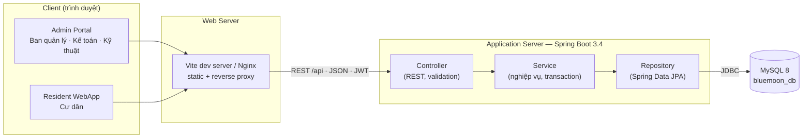
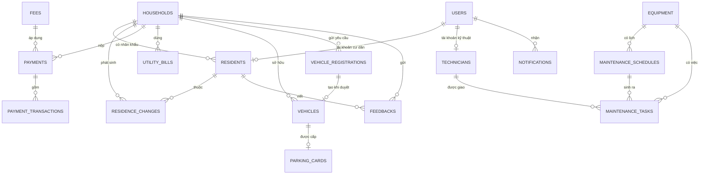

# Kiến trúc tổng thể — Hệ thống Quản lý Chung cư BlueMoon

| Thuộc tính | Giá trị |
|---|---|
| **Phiên bản** | 1.1 |
| **Ngày** | 26/11/2026 |
| **Người viết** | Lê Tùng Lâm (nhóm trưởng) |
| **Trạng thái** | Đang dùng |
| **Phạm vi** | Backend, frontend, cơ sở dữ liệu, triển khai |
| **Tài liệu liên quan** | `README.md`, `frontend/README.md`, `docs/ke-hoach-chia-viec.md`, `docs/chi-tiet-cong-viec.md` |

---

## 0. Tóm tắt và các quyết định đã chốt

### 0.1 Tóm tắt

BlueMoon là hệ thống web quản lý chung cư cho Ban quản lý, Kế toán, Đơn vị kỹ thuật và Cư dân.
Hệ thống số hóa 5 nghiệp vụ: quản lý cư dân — căn hộ, thu phí — công nợ, phản ánh — yêu cầu dịch vụ,
bảo trì — vận hành, đăng ký gửi xe — thẻ gửi xe. Giao diện gồm **Admin Portal** (quản trị) và
**Resident WebApp** (cư dân), dùng chung một ứng dụng React và phân quyền theo vai trò.

Nền tảng kỹ thuật giữ nguyên như code hiện tại: **React 19 + Vite 8** cho frontend,
**Spring Boot 3.4 + Java 21 + Spring Data JPA** cho backend, **MySQL 8** cho cơ sở dữ liệu.
Bổ sung **JWT + phân quyền theo vai trò (RBAC)**, chuẩn hóa REST API và các bảng dữ liệu còn thiếu.

Cách phát triển là **bồi đắp trên code hiện tại**, không viết lại: giữ 8 bảng đã có, thêm 9 bảng mới,
giữ nguyên kiến trúc phân lớp Controller → Service → Repository, giữ giao diện và design system hiện có.

### 0.2 Các quyết định thiết kế

| Mã | Quyết định | Lý do | Ảnh hưởng |
|---|---|---|---|
| D1 | Bồi đắp trên code hiện tại, không dựng lại dự án | Đã có ~4.500 dòng mã nguồn chạy được: 8 entity, 8 repository, 10 màn hình Admin, design system, seed data; dựng lại tốn 1–2 tuần mà không thêm giá trị nộp bài | Giữ tên bảng, API `/api`, cấu trúc thư mục; chỉ thêm phần thiếu |
| D2 | Giữ **MySQL 8** | Code, seed data, `.env`, README và máy của cả nhóm đang chạy MySQL; đổi CSDL không giải quyết khoảng cách nghiệp vụ | Spec, README và script dùng MySQL |
| D3 | Giữ tên bảng hiện tại | Đổi tên bảng kéo theo đổi entity, DTO, API, frontend nhưng không đổi nghiệp vụ | Không cần đổi entity/DTO/API/frontend |
| D4 | Hai cổng trong **một** ứng dụng React, phân quyền theo vai trò | Tránh dựng 2 dự án frontend, dùng lại component/design system; cư dân và nhân viên không bao giờ dùng chung màn hình | Thêm route theo vai trò, layout và trang cho cư dân |
| D5 | Xác thực bằng **JWT stateless**, mật khẩu băm **BCrypt** | Phù hợp REST, không cần session, đúng yêu cầu bảo mật của dự án | Thêm `spring-boot-starter-security`, bộ lọc JWT, `SecurityConfig` |
| D6 | Không thêm thư viện frontend mới (giữ Context + `fetch`) | Code hiện tại đã có `apiClient`, `normalize`, Context; thêm thư viện ngoài chỉ tăng việc học và việc sửa | Viết hook theo từng phân hệ, không dựng global store mới |
| D7 | Thanh toán **nội bộ**, không tích hợp cổng thanh toán thật | Tích hợp thật cần tài khoản, webhook, pháp lý; ngoài phạm vi môn học | Cư dân tạo giao dịch, Kế toán duyệt; ghi rõ là mô phỏng |
| D8 | Thông báo **trong ứng dụng**, không realtime | Đủ đáp ứng luồng "gửi thông báo" của 5 ca sử dụng; WebSocket là ngoài phạm vi | Bảng `notifications` + chuông thông báo, làm mới khi tải trang |
| D9 | Ảnh đính kèm phản ánh: **hoãn**, làm ở GĐ4 nếu còn thời gian | Cần cấu hình lưu file, kiểm tra loại/kích thước; không phải điều kiện hoàn thành của UC03 | Trường `attachment_url` để sẵn, chưa có API upload |
| D10 | Migration bằng **script SQL có phiên bản**, không dùng Flyway | Nhóm nhỏ, CSDL nhỏ; script dễ đọc, dễ chạy lại khi demo | `database/init_database.sql` (v2) + `database/migrations/` |

> **Nguyên tắc:** spec này là nguồn chuẩn cho sản phẩm BlueMoon. Khi tài liệu khác lệch với spec, spec thắng.

---

## 1. Bối cảnh, mục tiêu, phạm vi

### 1.1 Bài toán

Ban quản lý chung cư BlueMoon đang quản lý hộ khẩu, nhân khẩu, thu phí, phản ánh, bảo trì và gửi xe
bằng hồ sơ giấy và bảng tính rời rạc. Hệ quả: tra cứu chậm, dễ sai khi tính phí, khó đối soát công nợ,
phản ánh của cư dân không có nơi theo dõi, lịch bảo trì thiết bị dễ bỏ sót, thẻ gửi xe không có lịch sử.

### 1.2 Mục tiêu

1. Một nguồn dữ liệu duy nhất cho hộ gia đình, nhân khẩu, khoản thu, thanh toán, phản ánh, thiết bị, phương tiện.
2. Số hóa trọn 5 quy trình nghiệp vụ, mỗi quy trình có trạng thái rõ ràng và lịch sử thay đổi.
3. Phân quyền đúng vai trò: Ban quản lý, Kế toán, Kỹ thuật, Cư dân.
4. Cư dân tự tra cứu hóa đơn, gửi phản ánh, đăng ký gửi xe qua Resident WebApp.
5. Báo cáo, thống kê phục vụ vận hành: doanh thu, công nợ, phản ánh theo quý, tình trạng bảo trì.
6. Giao diện responsive, dùng được trên Chrome, Firefox, Edge; hỗ trợ bàn phím.

### 1.3 Hiện trạng code và khoảng cách

| Hạng mục | Hiện có | Còn thiếu |
|---|---|---|
| Backend | 8 entity, 8 repository, 8 service, 9 controller (8 nghiệp vụ + health); API `GET` danh sách; health check | Toàn bộ API ghi (POST/PUT/PATCH/DELETE); đăng nhập, phân quyền; validation; xử lý lỗi; phân trang; nghiệp vụ |
| Frontend | React 19 + Vite, 10 màn hình Admin + đăng nhập, design system, login tạm ở client, dữ liệu mẫu + `localStorage` | Gọi API thật; đăng nhập thật; route theo vai trò; cổng cư dân; form thêm/sửa; màn hình phản ánh, bảo trì, đăng ký xe |
| Cơ sở dữ liệu | 8 bảng: `users`, `households`, `residents`, `residence_changes`, `fees`, `payments`, `vehicles`, `utility_bills` | Bảng cho phản ánh, thiết bị, lịch/công việc bảo trì, kỹ thuật viên, đăng ký gửi xe, thẻ gửi xe, giao dịch thanh toán, thông báo |
| Kiểm thử | 3 lớp smoke test (controller, repository, kết nối CSDL) | Unit test cho service, test luồng nghiệp vụ, bộ test Postman, checklist UAT |
| Tài liệu | README cài đặt | Spec kiến trúc (tài liệu này), kế hoạch chia việc, chi tiết công việc, API/DB dictionary, kịch bản demo |

**Kết luận:** phần đã có là **khung** (entity, repository, giao diện, dữ liệu mẫu), chưa phải hệ thống chạy được.
Khối lượng còn lại nằm ở API ghi, xác thực, nghiệp vụ và các phân hệ mới — đây là cơ sở để chia 4 giai đoạn.

### 1.4 Trong phạm vi

- 5 nghiệp vụ: UC01 cư dân — căn hộ, UC02 thu phí — công nợ, UC03 phản ánh — yêu cầu dịch vụ,
  UC04 bảo trì — vận hành, UC05 đăng ký gửi xe — thẻ gửi xe.
- Đăng nhập, đăng ký, đổi mật khẩu, phân quyền 5 vai trò.
- Admin Portal và Resident WebApp trong cùng ứng dụng React.
- Thông báo trong ứng dụng; báo cáo, thống kê cơ bản.
- Cơ sở dữ liệu MySQL 8, script khởi tạo và dữ liệu mẫu.
- Kiểm thử backend, bộ test API, kịch bản demo.

### 1.5 Ngoài phạm vi

- Ứng dụng di động native (Android/iOS); thay bằng web responsive.
- Cổng thanh toán thật (VNPay, Momo, ngân hàng); chỉ mô phỏng giao dịch nội bộ.
- Xác thực hai yếu tố (2FA), mã hóa dữ liệu tại chỗ (encryption at rest).
- Thông báo realtime (WebSocket), email/SMS.
- Camera, barrier, GIS, AI phân loại phản ánh, đa chung cư.
- Ứng dụng cho thuê/cư dân tạm trú ngoài mô hình hộ gia đình — căn hộ cho thuê vẫn gắn với một hộ.

---

## 2. Tác nhân và phân quyền

### 2.1 Vai trò

| Vai trò (enum) | Tên hiển thị | Phạm vi sử dụng | Quyền chính |
|---|---|---|---|
| `ADMIN` | Quản trị hệ thống | Admin Portal | Toàn quyền; quản lý tài khoản nhân viên; cấu hình |
| `MANAGER` | Ban quản lý | Admin Portal | Quản lý hộ, nhân khẩu, phản ánh, bảo trì, gửi xe; xem báo cáo; duyệt yêu cầu |
| `ACCOUNTANT` | Kế toán | Admin Portal | Khoản thu, thu phí, công nợ, thu hộ điện nước, báo cáo tài chính |
| `TECHNICIAN` | Đơn vị kỹ thuật | Admin Portal (giới hạn) | Xem công việc được giao; cập nhật tiến độ, kết quả bảo trì |
| `RESIDENT` | Cư dân | Resident WebApp | Xem hóa đơn, thanh toán, gửi phản ánh, đăng ký gửi xe, xem thông báo |

`users.role` hiện có 3 giá trị (`ADMIN`, `MANAGER`, `ACCOUNTANT`); bổ sung `TECHNICIAN`, `RESIDENT`.
Tài khoản cư dân liên kết với nhân khẩu qua `users.resident_id` (nullable, unique).
Tài khoản kỹ thuật liên kết với hồ sơ kỹ thuật qua `technicians.user_id` (nullable, unique).

### 2.2 Ma trận quyền

Ký hiệu: **F** toàn quyền, **R** chỉ đọc, **O** chỉ dữ liệu của mình, **—** không có quyền.

| Chức năng | ADMIN | MANAGER | ACCOUNTANT | TECHNICIAN | RESIDENT |
|---|:--:|:--:|:--:|:--:|:--:|
| Tài khoản nhân viên | F | — | — | — | — |
| Hộ gia đình, nhân khẩu, biến động | F | F | R | — | O |
| Khoản thu (tạo, sửa, đóng) | F | R | F | — | R |
| Thu phí, giao dịch, duyệt thanh toán | F | R | F | — | O |
| Thu hộ điện, nước, internet | F | R | F | — | O |
| Phản ánh, yêu cầu dịch vụ | F | F | — | R (việc liên quan) | O + tạo mới |
| Thiết bị, lịch bảo trì | F | F | — | R | — |
| Công việc bảo trì | F | F | — | O + cập nhật tiến độ | — |
| Đăng ký gửi xe, thẻ gửi xe | F | F | R | — | O + tạo mới |
| Báo cáo, thống kê | F | F | F | — | — |
| Thông báo | F | F | R | R | O |

Quy tắc bổ sung:

- **Manager/Admin** được duyệt hoặc từ chối yêu cầu (phản ánh, đăng ký xe); Kế toán không được duyệt.
- **Kế toán** là người duy nhất ghi nhận/duyệt giao dịch thanh toán; Manager chỉ xem.
- **Kỹ thuật** chỉ thấy công việc có `technician_id` là mình; không thấy dữ liệu tài chính, nhân khẩu.
- **Cư dân** chỉ thấy dữ liệu thuộc hộ của mình; mọi truy vấn phải lọc theo `household_id` từ token,
  không tin `householdId` do client gửi lên.

---

## 3. Phân hệ chức năng

### 3.1 Năm nghiệp vụ

| Mã | Nghiệp vụ | Tác nhân chính | Chức năng chính | Trạng thái chính | Màn hình |
|---|---|---|---|---|---|
| UC01 | Quản lý cư dân và căn hộ | Ban quản lý, Cư dân (xem) | CRUD hộ gia đình, nhân khẩu; tìm kiếm, lọc; ghi nhận biến động (tạm trú, tạm vắng, chuyển đến/đi); xem hồ sơ hộ | Hộ: `ACTIVE`, `MOVED_OUT`; nhân khẩu: `PERMANENT`, `TEMPORARY_RESIDENCE`, `TEMPORARY_ABSENCE`, `MOVED_OUT` | Hộ gia đình, Nhân khẩu, Biến động |
| UC02 | Quản lý thu phí và công nợ | Kế toán, Cư dân (thanh toán) | CRUD khoản thu; sinh hóa đơn hàng loạt; ghi nhận thanh toán (tiền mặt/chuyển khoản), thanh toán một phần; duyệt giao dịch; theo dõi công nợ; thu hộ điện nước; biên lai | Khoản thu: `OPEN`, `CLOSED`; hóa đơn: `UNPAID`, `PARTIAL`, `PAID`; giao dịch: `PENDING`, `APPROVED`, `REJECTED` | Khoản thu, Thu phí, Thu hộ, Công nợ (cư dân) |
| UC03 | Quản lý phản ánh, yêu cầu dịch vụ | Cư dân, Ban quản lý, Kỹ thuật | Gửi phản ánh; phân loại, ưu tiên; giao việc; cập nhật phản hồi; gộp yêu cầu trùng; thống kê theo quý | `NEW`, `IN_PROGRESS`, `RESOLVED`, `REJECTED` | Phản ánh (Admin), Gửi phản ánh (Cư dân) |
| UC04 | Quản lý bảo trì và vận hành | Ban quản lý, Kỹ thuật | CRUD thiết bị; lập lịch bảo trì định kỳ; ghi nhận sự cố; phân công kỹ thuật; cập nhật tiến độ, kết quả; nghiệm thu; lịch sử bảo trì | Công việc: `PENDING`, `IN_PROGRESS`, `DONE`, `CANCELLED`; thiết bị: `ACTIVE`, `BROKEN`, `MAINTENANCE` | Thiết bị, Lịch bảo trì, Công việc (Admin + Kỹ thuật) |
| UC05 | Quản lý đăng ký gửi xe, thẻ gửi xe | Cư dân, Ban quản lý | Gửi yêu cầu đăng ký xe; duyệt/từ chối kèm lý do; tạo hồ sơ phương tiện; cấp thẻ; khóa, cấp lại thẻ; lịch sử | Yêu cầu: `PENDING`, `APPROVED`, `REJECTED`; xe: `ACTIVE`, `INACTIVE`; thẻ: `ACTIVE`, `LOCKED`, `REPLACED` | Đăng ký gửi xe (Cư dân), Duyệt đăng ký, Thẻ gửi xe (Admin) |

### 3.2 Phân hệ dùng chung

- **Xác thực và tài khoản:** đăng nhập, đăng ký cư dân, đổi mật khẩu, đăng xuất; quản lý tài khoản nhân viên.
- **Thông báo:** thông báo trong ứng dụng khi có hóa đơn mới, phản ánh được phản hồi, đăng ký xe được duyệt,
  công việc bảo trì được giao. Người dùng xem danh sách, đánh dấu đã đọc.
- **Báo cáo, thống kê:** tổng quan thu — chi theo tháng, công nợ theo khoản thu, phản ánh theo quý,
  tình trạng bảo trì, số hộ/nhân khẩu.

### 3.3 Trạng thái nghiệp vụ

| Nhóm | Giá trị | Ghi chú |
|---|---|---|
| Vai trò | `ADMIN`, `MANAGER`, `ACCOUNTANT`, `TECHNICIAN`, `RESIDENT` | Mở rộng enum `users.role` |
| Trạng thái tài khoản | `ACTIVE`, `LOCKED` | Tài khoản bị khóa không đăng nhập được |
| Hộ gia đình | `ACTIVE`, `MOVED_OUT` | Không xóa cứng hộ đã có phát sinh tài chính |
| Nhân khẩu | `PERMANENT`, `TEMPORARY_RESIDENCE`, `TEMPORARY_ABSENCE`, `MOVED_OUT` | |
| Khoản thu | `OPEN`, `CLOSED` | Đóng khoản thu thì không sinh hóa đơn mới |
| Hóa đơn | `UNPAID`, `PARTIAL`, `PAID` | Suy ra từ `amount_due - Σ giao dịch đã duyệt` |
| Giao dịch | `PENDING`, `APPROVED`, `REJECTED` | Cư dân tạo → `PENDING`; Kế toán duyệt → `APPROVED` |
| Phản ánh | `NEW`, `IN_PROGRESS`, `RESOLVED`, `REJECTED` | Có thể gộp vào phản ánh khác |
| Thiết bị | `ACTIVE`, `BROKEN`, `MAINTENANCE` | |
| Công việc bảo trì | `PENDING`, `IN_PROGRESS`, `DONE`, `CANCELLED` | |
| Yêu cầu gửi xe | `PENDING`, `APPROVED`, `REJECTED` | Từ chối bắt buộc có lý do |
| Thẻ gửi xe | `ACTIVE`, `LOCKED`, `REPLACED` | Cấp lại tạo thẻ mới, thẻ cũ `REPLACED` |
| Lịch bảo trì | `PLANNED`, `DONE`, `CANCELLED` | Đến hạn thì sinh công việc bảo trì |
| Thông báo | `UNREAD`, `READ` | |

---

## 4. Kiến trúc logic

### 4.1 Sơ đồ tổng thể



Bốn lớp logic:

1. **Presentation** — React SPA, hai cổng dùng chung component, phân quyền ở route và ở menu.
2. **Business Logic** — service chứa quy tắc nghiệp vụ; controller chỉ ánh xạ request/response.
3. **Data Access** — repository JPA; không có SQL viết tay trừ truy vấn thống kê phức tạp (nếu cần).
4. **Database** — MySQL 8, InnoDB, `utf8mb4`, múi giờ `Asia/Ho_Chi_Minh`.

### 4.2 Backend — cấu trúc gói

```text
backend/src/main/java/com/bluemoon/
├── BlueMoonApplication.java
├── config/            # CorsConfig, JpaConfig (auditing), seed dữ liệu demo
├── controller/        # nhận HTTP, trả ResponseEntity
├── dto/               # *Request, *Response, PageResponse
├── entity/            # ánh xạ bảng
├── enums/             # RoleEnum, FeeType, FeeStatus, PaymentStatus, FeedbackStatus, ...
├── exception/         # GlobalExceptionHandler, BusinessException, ResourceNotFoundException
├── repository/        # JpaRepository + truy vấn dẫn xuất
├── security/          # JwtTokenProvider, JwtAuthFilter, UserDetailsServiceImpl, SecurityConfig
└── service/           # nghiệp vụ, @Transactional
```

Quy ước:

- **Controller** không chứa nghiệp vụ, không trả entity thô; nhận `@Valid` request DTO, trả response DTO.
- **Service** là nơi duy nhất mở transaction; mọi thao tác ghi dùng `@Transactional`.
- **Repository** dùng truy vấn dẫn xuất (`findByHouseholdId`, `existsByLicensePlate`…); truy vấn thống kê
  phức tạp đặt trong repository với `@Query` JPQL, không native SQL nếu tránh được.
- **DTO ↔ Entity** ánh xạ thủ công trong service (không thêm MapStruct); DTO đặt tên `XxxRequest` / `XxxResponse`.
- **Không** trả `password` ra ngoài; `UserResponse` không có trường mật khẩu.
- **Phân trang** mặc định 20 bản ghi/trang, tối đa 100; trả `PageResponse<T>`.

### 4.3 Frontend — cấu trúc thư mục

```text
frontend/src/
├── main.jsx, App.jsx        # entry, provider, router
├── app/                     # AppProvider, AuthProvider, route guards, layout theo vai trò
├── components/              # UI kit dùng chung: Modal, Toast, Table, FormField, Icons
├── features/
│   ├── auth/                # login, register, đổi mật khẩu
│   ├── households/          # UC01: hộ, nhân khẩu, biến động
│   ├── fees/                # UC02: khoản thu, thu phí, công nợ, thu hộ
│   ├── feedbacks/           # UC03
│   ├── maintenance/         # UC04
│   ├── vehicles/            # UC05
│   ├── notifications/       # thông báo
│   └── reports/             # thống kê
├── lib/
│   ├── apiClient.js         # fetch + JWT + xử lý lỗi chung
│   ├── resources.js         # registry endpoint + normalize
│   ├── format.js            # tiền, ngày, nhãn trạng thái
│   └── auth.js              # lưu/đọc token, giải mã payload
├── pages/                   # trang Admin hiện có (giữ nguyên, chuyển dần vào features/)
└── styles.css               # design system hiện có
```

Quy ước:

- Mỗi phân hệ tự chứa `api.js`, `hooks.js`, `pages/`, `components/`; không import chéo giữa các phân hệ.
- Dữ liệu dùng chung (danh mục hộ, khoản thu) lấy qua hook của phân hệ sở hữu, không copy state.
- Không dùng `localStorage` để lưu dữ liệu nghiệp vụ sau GĐ1; chỉ lưu token và tuỳ chọn giao diện.
- Giữ `HashRouter` (đơn giản khi triển khai tĩnh, không cần cấu hình fallback).
- Mọi trang gọi API đều có trạng thái: đang tải, rỗng, lỗi; không fallback im lặng sang dữ liệu mẫu.

### 4.4 Luồng xử lý mẫu — duyệt đăng ký gửi xe

1. Cư dân mở form, nhập biển số, loại xe, chủ sở hữu → `POST /api/vehicle-registrations`.
2. Frontend kiểm tra định dạng cơ bản; backend kiểm tra bắt buộc, trùng biển số, hộ còn hoạt động.
3. Yêu cầu lưu với `PENDING`; tạo thông báo cho Ban quản lý.
4. Ban quản lý mở danh sách yêu cầu, xem chi tiết hộ và nhân khẩu liên quan.
5. Duyệt → `PATCH /api/vehicle-registrations/{id}/approve`:
   service tạo `vehicles` (nếu chưa có), cấp `parking_cards` với mã thẻ, cập nhật yêu cầu `APPROVED`,
   ghi thông báo cho cư dân, tất cả trong một transaction.
6. Từ chối → nhập lý do, cập nhật `REJECTED` + lý do, gửi thông báo.
7. Cư dân thấy trạng thái mới trong "Đăng ký gửi xe"; thẻ hiển thị mã, trạng thái, ngày cấp.

### 4.5 Nguyên tắc thiết kế

- **Một nguồn sự thật:** trạng thái suy ra từ dữ liệu (công nợ = phải thu − đã thu), không lưu trùng nếu tránh được;
  riêng `payments.amount_paid` giữ bản sao để truy vấn nhanh và được cập nhật trong cùng transaction.
- **Bất biến nghiệp vụ:** không xóa cứng dữ liệu đã phát sinh giao dịch; dùng trạng thái.
- **Idempotent:** duyệt một yêu cầu hai lần không tạo hai thẻ; kiểm tra trạng thái trước khi ghi.
- **Kiểm tra quyền ở backend**, frontend chỉ ẩn/hiện cho đúng trải nghiệm.
- **Lỗi có mã:** mỗi lỗi nghiệp vụ có `code` ổn định để frontend hiển thị và test.

---

## 5. Kiến trúc triển khai

### 5.1 Môi trường phát triển (local)

```text
Trình duyệt
   │  http://localhost:5173
   ▼
Vite dev server (5173) ──/api (proxy thêm ở GĐ1)──► Spring Boot (8080) ──JDBC──► MySQL (3306)
```

- Backend: `mvn -f backend/pom.xml spring-boot:run`, cấu hình qua `.env` ở thư mục gốc.
- Frontend: `cd frontend && npm install && npm run dev`, chạy tại `5173`. Hiện `vite.config.js` **chưa** cấu hình
  proxy và frontend gọi `/api` tương đối, nên khi chưa có proxy thì ứng dụng dùng dữ liệu mẫu. GĐ1 bổ sung
  proxy `/api` → `http://localhost:8080` (hoặc đặt `VITE_API_BASE_URL=http://localhost:8080/api`).
- Cơ sở dữ liệu: chạy `database/init_database.sql` trên MySQL 8; dữ liệu mẫu kèm theo.
- Kiểm tra nhanh: `GET http://localhost:8080/api/health` trả `status: UP`, `dbConnected: true`.

### 5.2 Môi trường triển khai (đích)

```text
Trình duyệt ──HTTPS──► Nginx (443)
                        ├── /            → tệp tĩnh từ `npm run build` (frontend/dist)
                        └── /api         → reverse proxy → Spring Boot (8080)
                                                              └── MySQL (3306)
```

- Nginx phục vụ tệp tĩnh và chuyển tiếp `/api`; Spring Boot đóng gói `jar`, chạy bằng `java -jar`.
- MySQL chỉ mở trong mạng nội bộ, không truy cập từ Internet.
- HTTPS bắt buộc ở môi trường thật; local dùng HTTP.
- Sao lưu hằng ngày bằng `mysqldump`; quy trình phục hồi ghi trong tài liệu vận hành.
- Chưa triển khai cloud trong phạm vi môn học; cấu hình trên là đích để trình bày khi bảo vệ sản phẩm.

### 5.3 Cấu hình

| Biến | Ý nghĩa | Mặc định local |
|---|---|---|
| `DB_HOST`, `DB_PORT` | Địa chỉ MySQL | `localhost`, `3306` |
| `DB_NAME`, `DB_USER`, `DB_PASS` | CSDL và tài khoản | `bluemoon_db`, `root`, rỗng |
| `JWT_SECRET` | Khóa ký JWT (bắt buộc ở production) | sinh ngẫu nhiên, không commit |
| `JWT_EXPIRATION` | Thời hạn token (ms) | `28800000` (8 giờ) |
| `CORS_ALLOWED_ORIGINS` | Nguồn frontend được phép | `http://localhost:5173` |

- `.env` không commit; `.env.example` cập nhật đủ biến.
- `application.properties` đọc biến qua `${...:mặc định}`; không hard-code mật khẩu.

---

## 6. Mô hình dữ liệu

### 6.1 Các bảng hiện có (giữ nguyên)

| Bảng | Vai trò | Ghi chú |
|---|---|---|
| `users` | Tài khoản nhân viên và cư dân | Thêm `resident_id`, mở rộng `role`, băm mật khẩu |
| `households` | Hộ gia đình gắn với căn hộ | Gộp thông tin căn hộ (số, tầng, diện tích) và chủ hộ |
| `residents` | Nhân khẩu thuộc hộ | |
| `residence_changes` | Biến động nhân khẩu | Tạm trú, tạm vắng, chuyển đến/đi |
| `fees` | Khoản thu | Loại, cách tính, đơn giá, kỳ thu |
| `payments` | Nghĩa vụ phí của hộ theo khoản thu | `amount_due`, `amount_paid`, trạng thái |
| `vehicles` | Phương tiện đã được duyệt | Biển số unique, phí tháng |
| `utility_bills` | Hóa đơn thu hộ điện, nước, internet | Chỉ số, sản lượng, số tiền |

### 6.2 Các bảng bổ sung

| Bảng | Vai trò | Cột chính | Quan hệ |
|---|---|---|---|
| `payment_transactions` | Lịch sử giao dịch thanh toán | `id`, `payment_id`, `amount`, `method`, `paid_at`, `status`, `recorded_by`, `approved_by`, `approved_at`, `note` | N–1 `payments`; N–1 `users` |
| `feedbacks` | Phản ánh, yêu cầu dịch vụ | `id`, `household_id`, `resident_id`, `category`, `priority`, `content`, `status`, `response`, `responded_by`, `responded_at`, `merged_into_id`, `attachment_url`, `created_at` | N–1 `households`, `residents` |
| `equipment` | Thiết bị cần bảo trì | `id`, `name`, `location`, `status`, `installed_at`, `note` | |
| `maintenance_schedules` | Lịch bảo trì định kỳ | `id`, `equipment_id`, `planned_date`, `frequency`, `note`, `status` | N–1 `equipment` |
| `maintenance_tasks` | Công việc bảo trì, sự cố | `id`, `equipment_id`, `schedule_id`, `technician_id`, `title`, `description`, `priority`, `start_date`, `end_date`, `status`, `result`, `accepted_by`, `accepted_at` | N–1 `equipment`, `maintenance_schedules`, `technicians` |
| `technicians` | Hồ sơ nhân viên kỹ thuật | `id`, `full_name`, `specialty`, `phone`, `status`, `user_id` | 1–0..1 `users` |
| `vehicle_registrations` | Yêu cầu đăng ký gửi xe | `id`, `household_id`, `vehicle_id`, `license_plate`, `vehicle_type`, `brand`, `owner_name`, `status`, `reject_reason`, `requested_by`, `processed_by`, `processed_at` | N–1 `households` |
| `parking_cards` | Thẻ gửi xe | `id`, `vehicle_id`, `card_code`, `status`, `issued_date`, `locked_reason`, `replaced_by_id`, `note` | N–1 `vehicles` |
| `notifications` | Thông báo trong ứng dụng | `id`, `user_id`, `type`, `title`, `content`, `link`, `is_read`, `created_at` | N–1 `users` |

Bảng `users` bổ sung: `resident_id INT NULL UNIQUE`, `role` mở rộng, mật khẩu lưu BCrypt.

### 6.3 Sơ đồ quan hệ



### 6.4 Quy ước dữ liệu

- Khóa chính: `INT AUTO_INCREMENT`; khóa ngoại cùng kiểu với bảng được tham chiếu.
- Tiền: `DECIMAL(12,2)`; diện tích: `DECIMAL(8,2)`; tỷ lệ phần trăm không lưu, tính khi cần.
- Thời gian: `TIMESTAMP`/`DATETIME`, múi giờ `Asia/Ho_Chi_Minh`; audit `created_at`, `updated_at`
  do Hibernate gán (`@CreationTimestamp`, `@UpdateTimestamp`).
- Trạng thái: dùng `ENUM` của MySQL như schema hiện tại, giá trị viết HOA; thêm giá trị mới phải sửa cả script và entity.
- Xóa: không xóa cứng dữ liệu đã phát sinh; dùng trạng thái hoặc `ON DELETE SET NULL` cho tham chiếu mềm.
  Chỉ xóa cứng hộ/nhân khẩu chưa có thanh toán, phản ánh, phương tiện.
- Chỉ mục đề xuất: `feedbacks(status, created_at)`, `maintenance_tasks(technician_id, status)`,
  `vehicle_registrations(status)`, `parking_cards(status)`, `notifications(user_id, is_read)`,
  `payment_transactions(payment_id, status)`.

### 6.5 Chiến lược migration

- `database/init_database.sql`: script khởi tạo đầy đủ cho máy mới — cập nhật lên **v2** ở GĐ1, gồm 8 bảng cũ +
  9 bảng mới + dữ liệu mẫu + tài khoản mẫu (mật khẩu đã băm).
- `database/migrations/`: các script thay đổi tăng dần cho máy đã có dữ liệu, đặt tên
  `YYYYMMDD-mo-ta.sql`, mỗi script chạy được một lần, có ghi chú ở đầu.
- Không dùng `ddl-auto=update`; giữ `none` để CSDL do script kiểm soát.
- Khi demo: máy mới chạy `init_database.sql`; máy đã có dữ liệu chạy lần lượt các migration.
- Dữ liệu mẫu phải đủ để demo cả 5 nghiệp vụ: ít nhất 8 hộ, 13 nhân khẩu, 6 khoản thu, 10 giao dịch,
  3 phản ánh ở 3 trạng thái, 4 thiết bị + 3 công việc, 2 yêu cầu gửi xe, 2 thẻ.

---

## 7. Thiết kế API

### 7.1 Nguyên tắc

- Base path `/api`; tài nguyên số nhiều, danh từ, chữ thường, gạch nối: `/api/vehicle-registrations`.
- Dùng đúng phương thức: `GET` đọc, `POST` tạo, `PUT` thay toàn bộ, `PATCH` cập nhật một phần/hành động, `DELETE` xóa.
- Hành động nghiệp vụ dùng `PATCH /{id}/{action}`: `/approve`, `/reject`, `/close`, `/lock`, `/assign`, `/accept`.
- Không đặt động từ trong URL cho CRUD; không trả về entity thô.
- Mọi danh sách hỗ trợ `page`, `size`, `sort`; bộ lọc đặt trong query string.
- Không phiên bản hóa URL trong phạm vi môn học; thay đổi phá vỡ tương thích phải báo nhóm.

### 7.2 Xác thực

- `POST /api/auth/login` trả `{ token, user }`; client gửi `Authorization: Bearer <token>` cho mọi request sau.
- Token chứa `sub` (username), `role`, `userId`, `residentId` (nếu có), `exp`.
- Token hết hạn hoặc sai → `401`; thiếu quyền → `403`.
- Đăng ký cư dân: `POST /api/auth/register` tạo tài khoản `RESIDENT`, gắn với nhân khẩu/hộ nếu có.

### 7.3 Định dạng phản hồi

Thành công:

```json
{ "id": 12, "licensePlate": "29E1-123.45", "status": "APPROVED" }
```

Danh sách có phân trang:

```json
{
  "content": [ { "id": 1 } ],
  "page": 0,
  "size": 20,
  "totalElements": 42,
  "totalPages": 3
}
```

Lỗi:

```json
{
  "timestamp": "2026-11-26T10:15:30",
  "status": 409,
  "code": "LICENSE_PLATE_EXISTS",
  "message": "Biển số đã được đăng ký",
  "path": "/api/vehicle-registrations",
  "fieldErrors": [ { "field": "licensePlate", "message": "đã tồn tại" } ]
}
```

Mã HTTP: `200` đọc/cập nhật, `201` tạo, `204` xóa, `400` dữ liệu không hợp lệ, `401` chưa đăng nhập,
`403` không có quyền, `404` không tìm thấy, `409` trùng/vi phạm trạng thái, `500` lỗi hệ thống.

### 7.4 Danh sách endpoint chính

| Nhóm | Endpoint | Quyền |
|---|---|---|
| Auth | `POST /api/auth/login`, `POST /api/auth/register`, `GET /api/auth/me`, `PUT /api/auth/password` | Công khai / đã đăng nhập |
| Người dùng | `GET/POST /api/users`, `PUT /api/users/{id}`, `PATCH /api/users/{id}/status` | ADMIN |
| Hộ gia đình | `GET /api/households` (q, status, page), `GET/PUT/DELETE /api/households/{id}`, `POST /api/households`, `GET /api/households/{id}/residents` | ADMIN, MANAGER; cư dân xem hộ mình |
| Nhân khẩu | `GET /api/residents` (householdId, q, status), `POST /api/residents`, `PUT/DELETE /api/residents/{id}`, `GET /api/residents/{id}/changes` | ADMIN, MANAGER |
| Biến động | `GET/POST /api/residence-changes`, `PUT/DELETE /api/residence-changes/{id}` | ADMIN, MANAGER |
| Khoản thu | `GET /api/fees` (year, month, status), `POST /api/fees`, `PUT /api/fees/{id}`, `POST /api/fees/{id}/generate`, `POST /api/fees/{id}/close`, `GET /api/fees/{id}/debts` | ADMIN, ACCOUNTANT; MANAGER đọc |
| Thu phí | `GET /api/payments` (feeId, householdId, status), `GET /api/payments/{id}`, `POST /api/payments/{id}/transactions`, `GET /api/payments/{id}/transactions` | ACCOUNTANT; cư dân xem/tạo của mình |
| Duyệt giao dịch | `PATCH /api/transactions/{id}/approve`, `PATCH /api/transactions/{id}/reject` | ACCOUNTANT |
| Thu hộ | `GET/POST /api/utility-bills`, `PUT/DELETE /api/utility-bills/{id}`, `PATCH /api/utility-bills/{id}/pay` | ADMIN, ACCOUNTANT |
| Phản ánh | `GET /api/feedbacks` (status, category, from, to), `GET /api/feedbacks/{id}`, `POST /api/feedbacks`, `PATCH /api/feedbacks/{id}/status`, `POST /api/feedbacks/{id}/respond`, `POST /api/feedbacks/merge` | MANAGER/ADMIN; cư dân tạo và xem của mình |
| Thiết bị | `GET/POST /api/equipment`, `PUT/DELETE /api/equipment/{id}` | ADMIN, MANAGER |
| Lịch bảo trì | `GET/POST /api/maintenance-schedules`, `PUT/DELETE /api/maintenance-schedules/{id}` | ADMIN, MANAGER |
| Công việc bảo trì | `GET /api/maintenance-tasks` (technicianId, status), `POST /api/maintenance-tasks`, `PATCH /api/maintenance-tasks/{id}/assign`, `PATCH /api/maintenance-tasks/{id}/status`, `POST /api/maintenance-tasks/{id}/accept` | MANAGER/ADMIN; kỹ thuật cập nhật việc của mình |
| Kỹ thuật viên | `GET/POST /api/technicians`, `PUT /api/technicians/{id}` | ADMIN, MANAGER |
| Đăng ký gửi xe | `GET /api/vehicle-registrations` (status, householdId), `POST /api/vehicle-registrations`, `PATCH /api/vehicle-registrations/{id}/approve`, `PATCH /api/vehicle-registrations/{id}/reject` | Cư dân tạo; MANAGER/ADMIN duyệt |
| Phương tiện | `GET/POST /api/vehicles`, `PUT/DELETE /api/vehicles/{id}`, `PATCH /api/vehicles/{id}/status` | ADMIN, MANAGER |
| Thẻ gửi xe | `GET /api/parking-cards`, `POST /api/parking-cards`, `PATCH /api/parking-cards/{id}/lock`, `PATCH /api/parking-cards/{id}/reissue` | ADMIN, MANAGER; cư dân xem của mình |
| Thông báo | `GET /api/notifications`, `PATCH /api/notifications/{id}/read`, `PATCH /api/notifications/read-all` | Đã đăng nhập (của mình) |
| Thống kê | `GET /api/stats/overview`, `/revenue`, `/debts`, `/feedbacks`, `/maintenance`, `/residents` | ADMIN, MANAGER, ACCOUNTANT |
| Health | `GET /api/health` | Công khai |

### 7.5 Mã lỗi nghiệp vụ

| Mã | HTTP | Khi nào |
|---|---|---|
| `VALIDATION_ERROR` | 400 | Thiếu/sai định dạng trường bắt buộc |
| `INVALID_CREDENTIALS` | 401 | Sai tài khoản hoặc mật khẩu |
| `ACCOUNT_LOCKED` | 403 | Tài khoản bị khóa |
| `FORBIDDEN` | 403 | Không đủ quyền hoặc truy cập dữ liệu hộ khác |
| `NOT_FOUND` | 404 | Không tìm thấy bản ghi |
| `DUPLICATE_CODE` | 409 | Trùng mã hộ, mã khoản thu, biển số, mã thẻ |
| `HOUSEHOLD_INACTIVE` | 409 | Thao tác trên hộ đã chuyển đi |
| `FEE_CLOSED` | 409 | Sinh hóa đơn cho khoản thu đã đóng |
| `PAYMENT_OVERPAY` | 409 | Số tiền vượt quá dư nợ |
| `TRANSACTION_ALREADY_APPROVED` | 409 | Duyệt lại giao dịch đã duyệt |
| `REGISTRATION_NOT_PENDING` | 409 | Duyệt/từ chối yêu cầu không ở trạng thái chờ |
| `CARD_ALREADY_LOCKED` | 409 | Khóa thẻ đã khóa |
| `TASK_INVALID_STATE` | 409 | Chuyển trạng thái công việc không hợp lệ |
| `INTERNAL_ERROR` | 500 | Lỗi không mong đợi (không lộ chi tiết ra client) |

---

## 8. Bảo mật

### 8.1 Xác thực

1. Client gửi `username`/`password` tới `/api/auth/login`.
2. `UserDetailsServiceImpl` tải tài khoản; `BCryptPasswordEncoder` so khớp mật khẩu băm.
3. `JwtTokenProvider` tạo token ký HMAC-SHA256 bằng `JWT_SECRET`, hạn 8 giờ.
4. Mỗi request sau đi qua `JwtAuthFilter`: đọc header, kiểm tra chữ ký/hạn, nạp quyền vào `SecurityContext`.
5. `SecurityConfig` chặn mọi endpoint trừ `/api/auth/login`, `/api/auth/register`, `/api/health`;
   bật CORS, tắt session (`STATELESS`), tắt CSRF vì dùng Bearer token.

### 8.2 Phân quyền

- Ở backend: `@PreAuthorize("hasRole('ACCOUNTANT')")` hoặc kiểm tra trong service; quyền theo vai trò là chính,
  kiểm tra sở hữu dữ liệu (hộ của cư dân, việc của kỹ thuật) là bắt buộc.
- Ở frontend: route guard theo vai trò + ẩn menu; không thay thế kiểm tra backend.
- Nguyên tắc: **client không bao giờ gửi `householdId` cho hành động của cư dân**; backend lấy từ token.

### 8.3 Bảo vệ dữ liệu

- Mật khẩu: BCrypt, không trả ra API, không ghi log.
- Token: lưu `localStorage` (chấp nhận cho môn học); không đưa token vào URL; xóa khi đăng xuất.
- Dữ liệu cá nhân (CCCD, số điện thoại): chỉ vai trò có quyền mới thấy; không hiển thị CCCD đầy đủ cho cư dân khác.
- CORS: chỉ cho phép origin cấu hình; bỏ `@CrossOrigin` rải rác ở controller, dùng `CorsConfig` toàn cục.
- HTTPS ở production; không commit `.env`, không hard-code khóa.
- Audit: ghi `created_by`, `processed_by`, `collected_by`, `approved_by` cho hành động quan trọng.

### 8.4 Giới hạn đã biết

- Không có 2FA (ngoài phạm vi 4 giai đoạn); ghi vào phần hạn chế của sản phẩm.
- Không mã hóa dữ liệu tại chỗ; dựa vào quyền truy cập CSDL.
- Token lưu `localStorage` có rủi ro XSS; giảm thiểu bằng thời hạn ngắn và không render HTML từ dữ liệu người dùng.

---

## 9. Yêu cầu phi chức năng

| Nhóm | Yêu cầu | Cách đáp ứng trong phạm vi môn học | Ưu tiên |
|---|---|---|---|
| Hiệu năng | CRUD < 2 giây; dashboard < 3 giây; tìm kiếm nâng cao < 4 giây | Phân trang, chỉ mục, tránh N+1; đo bằng log thời gian ở `apiClient` | Must |
| Xử lý lô | Sinh hóa đơn 500 hộ < 15 giây | Sinh theo lô, một transaction, truy vấn tập hợp; test với 500 hộ giả lập | Must |
| Chịu tải | 100 người dùng đồng thời | Kiến trúc stateless; chưa load test thật, ghi rõ là mục tiêu thiết kế | Should |
| Mở rộng | 3.000 căn hộ, 6.000 cư dân | Khóa chính số, phân trang, chỉ mục; không giả định dữ liệu nhỏ trong code | Should |
| Khả dụng | 99,5%/tháng; sao lưu ngày; RTO 4 giờ | Local không cam kết; tài liệu hóa quy trình sao lưu/phục hồi | Could |
| Bảo mật | RBAC, HTTPS, băm mật khẩu | JWT + BCrypt + CORS; HTTPS ở production | Must |
| Bảo mật nâng cao | 2FA, mã hóa at-rest | Ngoài phạm vi; ghi vào hạn chế | — |
| Sử dụng | Trực quan, nhất quán, responsive; Chrome/Firefox/Edge | Giữ design system; kiểm tra 3 trình duyệt; hỗ trợ bàn phím | Must |
| Đa nền tảng | Android/iOS | Web responsive; ghi rõ ngoài phạm vi | — |
| Tài liệu | Hướng dẫn sử dụng cho BQL, Kế toán | README + tài liệu demo + slide | Must |

---

## 10. Quy ước mã nguồn và quy trình

### 10.1 Đặt tên

- Code (Java, JS, SQL): tiếng Anh; giao diện và thông báo lỗi: tiếng Việt.
- Java: `PascalCase` cho class, `camelCase` cho biến/phương thức, hằng số `UPPER_SNAKE_CASE`.
- Bảng/cột: `snake_case`; API: `camelCase` trong JSON.
- Nhánh Git: `feat/<ma-viec>-<mo-ta>`, `fix/...`, `docs/...`; ví dụ `feat/gd2-fee-generate`.
- Commit: `<loại>(<phạm vi>): <mô tả>` — `feat(fees): sinh hóa đơn hàng loạt`.

### 10.2 Quy trình Git

- `main` luôn chạy được; mỗi việc một nhánh từ `main`, merge bằng pull request.
- PR nhỏ (≤ 400 dòng thay đổi), có mô tả, ảnh chụp màn hình nếu là UI, và ít nhất 1 người review.
- Không commit `.env`, `node_modules`, `target`, dữ liệu cá nhân thật.
- Trước khi merge: build backend + frontend, chạy test, kiểm tra endpoint bằng Postman.

### 10.3 Definition of Done

Một việc được coi là xong khi:

1. Có API và/hoặc màn hình hoạt động end-to-end với dữ liệu thật (không phải dữ liệu mẫu).
2. Có kiểm tra quyền và validation ở backend.
3. Có test (service hoặc controller) hoặc checklist kiểm thử tay đã chạy.
4. Không lỗi console, không log mật khẩu/token.
5. Đã cập nhật tài liệu liên quan (API, DB, hướng dẫn) nếu hành vi thay đổi.
6. PR được review và merge vào `main`.

### 10.4 Môi trường và dữ liệu mẫu

- Mỗi thành viên chạy MySQL local với `database/init_database.sql`; không dùng chung CSDL từ xa.
- Dữ liệu mẫu cố định, không chứa thông tin thật; tài khoản demo: `admin`, `quanly`, `ketoan`, `kythuat`, `cudan`.
- Khi cần demo một luồng, dùng dữ liệu mẫu tương ứng; không sửa tay CSDL trong lúc demo.

---

## 11. Kiểm thử

### 11.1 Mức kiểm thử

| Mức | Phạm vi | Công cụ | Bắt buộc |
|---|---|---|---|
| Unit | Quy tắc nghiệp vụ trong service: tính phí, công nợ, chuyển trạng thái, duyệt yêu cầu | JUnit 5 + Mockito | Có |
| Integration | Controller + service + repository với CSDL thật | Spring Boot Test + MockMvc | Có |
| API thủ công | Toàn bộ endpoint theo vai trò | Postman collection | Có |
| Giao diện | Luồng chính trên 3 trình duyệt, responsive | Checklist tay | Có |
| Hiệu năng | Sinh hóa đơn 500 hộ | Script/seed + đo thời gian | Nên có |

### 11.2 Kịch bản tối thiểu

- UC01: thêm hộ, thêm nhân khẩu, trùng CCCD, chuyển hộ sang `MOVED_OUT`.
- UC02: sinh hóa đơn, thanh toán một phần, duyệt giao dịch, vượt dư nợ, đóng khoản thu.
- UC03: gửi phản ánh, đổi trạng thái, phản hồi, gộp trùng, thống kê quý.
- UC04: tạo thiết bị, lập lịch, giao việc, cập nhật tiến độ, nghiệm thu.
- UC05: gửi yêu cầu, duyệt, từ chối kèm lý do, khóa thẻ, cấp lại.
- Bảo mật: sai mật khẩu, token hết hạn, cư dân A xem dữ liệu hộ B (phải `403`).

### 11.3 Công cụ

- Backend: Maven Surefire, `spring-boot-starter-test`.
- API: Postman (collection commit trong `docs/postman/`).
- Giao diện: kiểm tra tay theo checklist; chưa thêm test runner frontend trong phạm vi.

---

## 12. Rủi ro và cắt phạm vi

### 12.1 Rủi ro

| Rủi ro | Dấu hiệu | Phương án |
|---|---|---|
| Lâm là điểm nghẽn review/tài liệu | PR tồn, gate trễ | Review theo PR nhỏ; AI hỗ trợ code; nếu trễ, cắt theo mục 12.2 |
| Thành viên mới chậm | Việc GĐ1 chưa xong | Chia việc UI rõ ràng, có màn hình mẫu; ghép cặp với Lâm/Đức Anh |
| Xung đột merge | Sửa cùng file | Mỗi người một nhánh theo phân hệ; PR nhỏ; rebase thường xuyên |
| Lệch schema | Entity và SQL không khớp | Migration có review; chạy `init_database.sql` trên máy sạch trước khi merge |
| JWT tích hợp muộn | GĐ2 vẫn chưa có login thật | Chốt GĐ1 bằng cổng kiểm soát: login + phân quyền chạy được mới sang GĐ2 |
| Sinh hóa đơn chậm | 500 hộ > 15 giây | Sinh theo lô, tránh truy vấn từng hộ; đo trước khi tối ưu |
| Mất dữ liệu khi demo | Chạy script sai | Sao lưu trước demo; dùng CSDL riêng cho demo |

### 12.2 Thứ tự cắt phạm vi (khi trễ)

1. Ảnh đính kèm phản ánh (D9).
2. Thông báo trong ứng dụng (giữ thông báo qua trạng thái/màn hình).
3. Biểu đồ thống kê nâng cao (giữ bảng số liệu).
4. Lịch bảo trì định kỳ tự sinh công việc (giữ tạo công việc thủ công).
5. Cấp lại thẻ gửi xe (giữ cấp mới + khóa).
6. Cổng cư dân thanh toán (giữ xem hóa đơn; Kế toán ghi nhận).

Không cắt: đăng nhập/phân quyền, CRUD 5 nghiệp vụ, duyệt yêu cầu, kiểm thử luồng chính, tài liệu bàn giao.

---

## 13. Lộ trình 4 giai đoạn

| Giai đoạn | Thời lượng | Mục tiêu | Kết quả kiểm chứng |
|---|---|---|---|
| GĐ1 — Nền tảng & khung | 4 ngày | JWT + RBAC, chuẩn API, DB v2, mỗi nghiệp vụ có entity/repo + API `GET` + trang danh sách | Đăng nhập 5 vai trò; 5 nhóm `GET` trả JSON; `mvn test` + `npm run build` pass |
| GĐ2 — CRUD chính | 4 ngày | UC01 + UC02 CRUD end-to-end; mỗi nghiệp vụ có form thêm/sửa/xóa | Tạo hộ/nhân khẩu; sinh hóa đơn; nộp + duyệt thanh toán; công nợ đúng |
| GĐ3 — Luồng nghiệp vụ & cổng cư dân | 4 ngày | UC03 + UC04 + UC05 hoàn chỉnh; cư dân dùng được; kỹ thuật cập nhật việc | 5 luồng demo được; cư dân không thấy dữ liệu hộ khác |
| GĐ4 — Chốt & bàn giao | 3 ngày | Kiểm thử, seed, sửa lỗi, tài liệu, demo, tag | Demo 5 luồng; test/build xanh; tài liệu đủ; tag `v1.0` |

Lịch, phân công và hạn nằm trong `docs/ke-hoach-chia-viec.md`; chi tiết từng việc theo người nằm trong `docs/chi-tiet-cong-viec.md`.

---

## 14. Phụ lục

### 14.1 Thuật ngữ

| Thuật ngữ | Nghĩa |
|---|---|
| Hộ gia đình | Đơn vị quản lý gắn với một căn hộ; có chủ hộ và các nhân khẩu |
| Nhân khẩu | Cá nhân thường trú/tạm trú/tạm vắng thuộc một hộ |
| Khoản thu | Loại phí áp dụng cho các hộ trong một kỳ |
| Hóa đơn (nghĩa vụ) | Số tiền một hộ phải nộp cho một khoản thu |
| Công nợ | Phần chưa nộp = phải thu − đã thu |
| Giao dịch | Một lần nộp tiền cho hóa đơn; cần Kế toán duyệt |
| Phản ánh | Yêu cầu/khiếu nại của cư dân gửi Ban quản lý |
| Công việc bảo trì | Việc sửa chữa/bảo trì thiết bị, giao cho kỹ thuật |
| Thẻ gửi xe | Mã định danh cấp cho phương tiện đã được duyệt |
| RBAC | Phân quyền theo vai trò |

### 14.2 Tham chiếu

- Mã nguồn hiện tại: `backend/`, `frontend/`, `database/init_database.sql`.
- Hướng dẫn cài đặt: `README.md`, `frontend/README.md`.
- Kế hoạch chia việc: `docs/ke-hoach-chia-viec.md` (lịch, phân công, hạn).
- Chi tiết công việc: `docs/chi-tiet-cong-viec.md` (task ID, việc, file, xong khi).
